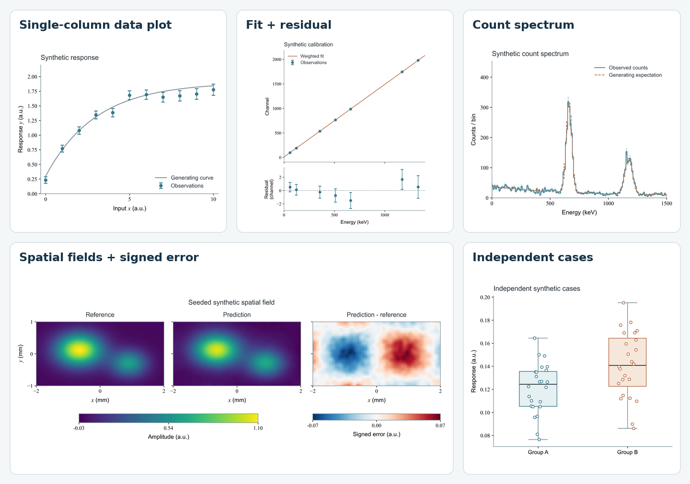
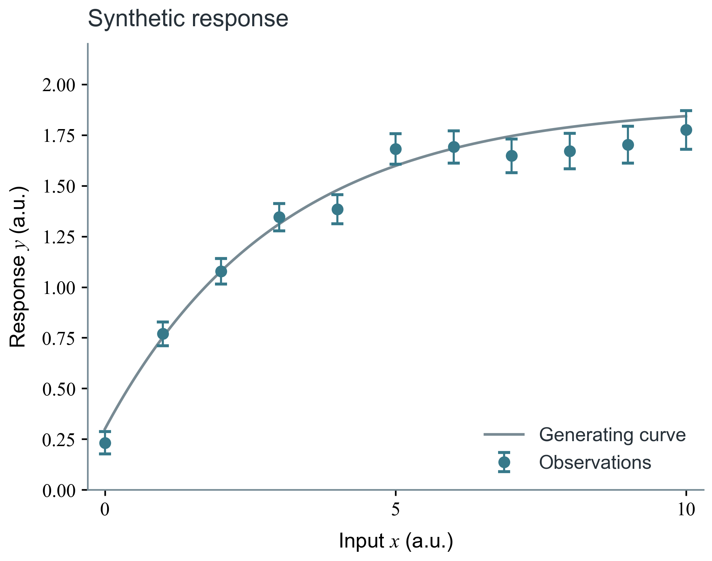
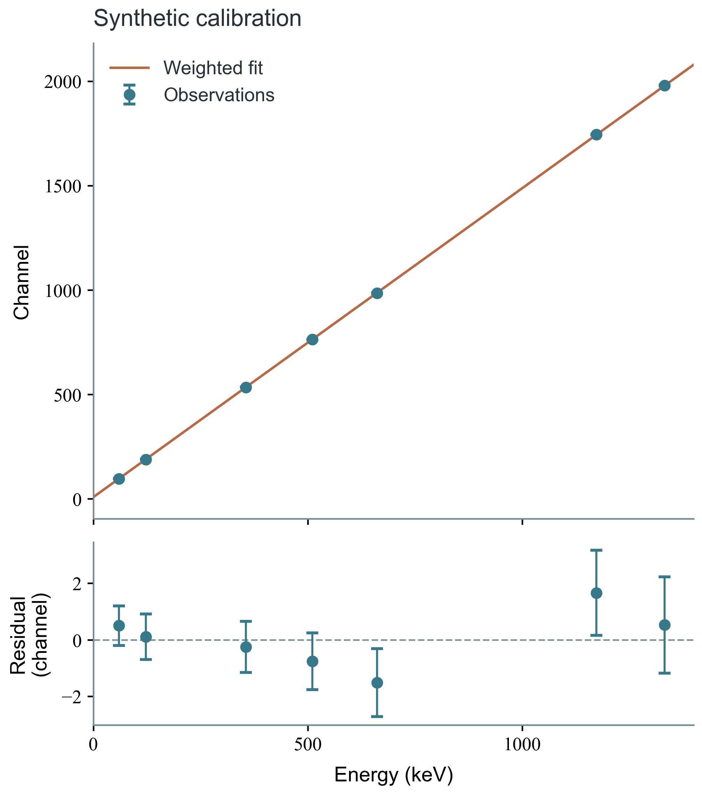
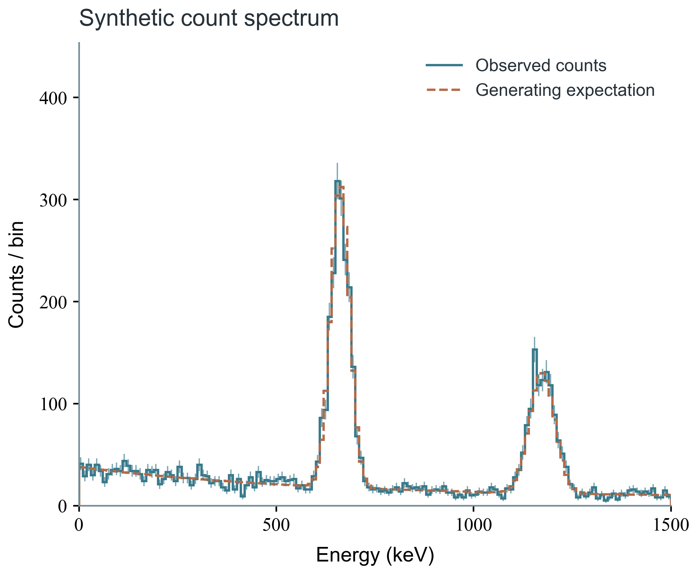
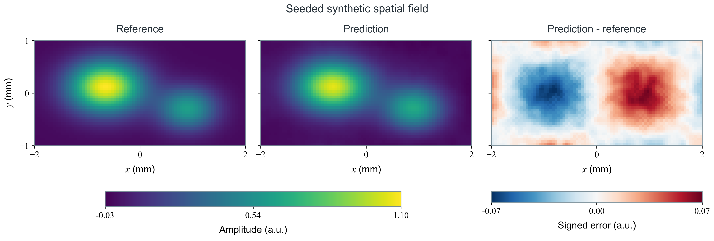
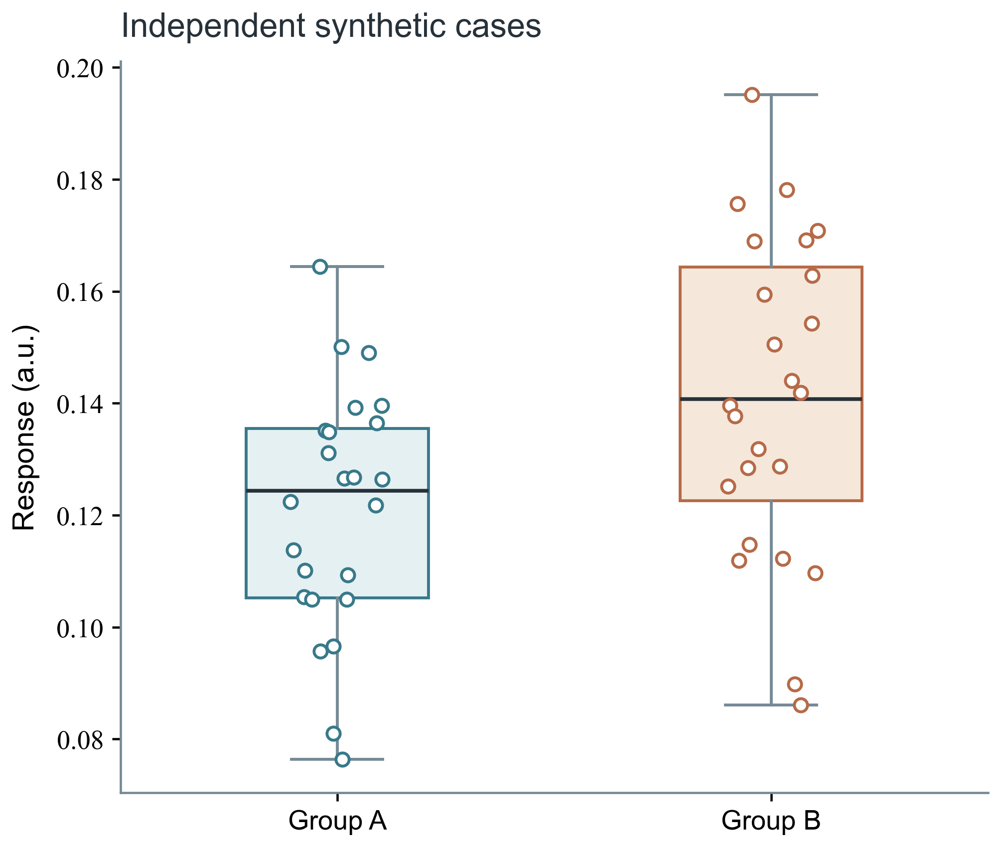
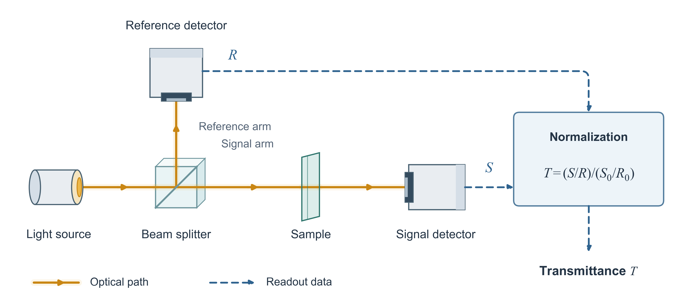

# ohmyplt

**Clear scientific figures, from single plots to research panels.**

An agent skill for data plots, statistical comparisons, research panels, experimental schematics, and model diagrams. Work from your data, plotting code, or method description; keep editable SVG text, PDF/PNG exports, and Python source.

[简体中文](README.zh-CN.md) · [Install](#install) · [Quickstart](#quickstart) · [Gallery](#gallery)

[](https://github.com/Lee-Eee-Eee/ohmyplt/actions/workflows/smoke.yml)
[](LICENSE)



## Choose the figure you need

| Task | Drawing approach | Attention goes to |
|---|---|---|
| **Single data plot** | Ordinary Matplotlib axes | Data, units, scales, uncertainty, readable labels |
| **Research panels** | Coordinated subplots and shared encodings | Fits and residuals, paired cases, distributions, comparable fields |
| **Schematic or architecture** | Physical objects, operations and connections | Experimental relationships, method flow, shapes, shared parameters |

Simple plots use a short drawing path. Research panels add the layout and statistical conventions they need; schematics use the optional millimetre-based components. Defaults are Arial labels and Times New Roman mathematics and numeric ticks. Your project, journal, or font choices can override them.

## Install

With the [Skills CLI](https://github.com/vercel-labs/skills) and Node.js 22.20+:

```bash
npx skills add Lee-Eee-Eee/ohmyplt --skill ohmyplt
```

Choose your agent when prompted; add `-g` for installation across projects. Install Python dependencies in the environment that runs the scripts. For a manual Codex installation:

```bash
git clone https://github.com/Lee-Eee-Eee/ohmyplt.git ~/.codex/skills/ohmyplt
python -m pip install -r ~/.codex/skills/ohmyplt/requirements.txt
```

Invoke `$ohmyplt` in Codex. Other agents can load [SKILL.md](SKILL.md) through their skill mechanism.

## Quickstart

Python 3.10+ is required. Clone into a working folder and render one plot:

```bash
git clone https://github.com/Lee-Eee-Eee/ohmyplt.git
cd ohmyplt
python -m pip install -r requirements.txt
python scripts/quickstart.py --portable --out output
```

Open `output/simple-plot.png`. The same folder contains SVG/PDF, synthetic example data, a caption, and manifests. Paths are relative to where you run the command.

`--portable` explicitly selects Matplotlib's bundled DejaVu Sans/Serif. Omit it for Arial/Times, register your own fonts with `--font-dir PATH`, or select `--body-font` and `--math-font`.

Choose another example with `--example calibration`, `spectrum`, `heatmap`, `distribution`, `data`, `optical`, `comparison`, or `network`; `simple` is the default. Add `--check` for PDF text/collision inspection and a final-size preview. To render and inspect the full gallery for development or CI:

```bash
python scripts/quickstart.py --example all --portable --check --out output
```

## Gallery

The runnable examples use seeded synthetic data and initialized demonstration weights. Gallery figures use Arial/Times; the Matplotlib baseline in the style comparison retains its default fonts. Each drawing example accepts explicit font arguments.

### Data plots and research panels

| Single curve and error bars | Calibration and residuals |
|---|---|
|  |  |
| [Python](examples/simple_plot.py) · [SVG](assets/gallery/simple-plot.svg) · [PDF](assets/gallery/simple-plot.pdf) | [Python](examples/scientific_plots.py) · [SVG](assets/gallery/calibration.svg) · [PDF](assets/gallery/calibration.pdf) |

| Count spectrum | Comparable spatial fields |
|---|---|
|  |  |
| [Python](examples/scientific_plots.py) · [SVG](assets/gallery/spectrum.svg) · [PDF](assets/gallery/spectrum.pdf) | [Python](examples/scientific_plots.py) · [SVG](assets/gallery/heatmap.svg) · [PDF](assets/gallery/heatmap.pdf) |

| Distributions and individual cases | Paired cases and a time forecast |
|---|---|
|  |  |
| [Python](examples/scientific_plots.py) · [SVG](assets/gallery/distribution.svg) · [PDF](assets/gallery/distribution.pdf) | [Python](examples/data_plot.py) · [SVG](assets/gallery/data-plot.svg) · [PDF](assets/gallery/data-plot.pdf) |

Run a research recipe with `python examples/scientific_plots.py --kind calibration --out output`. Other kinds are `spectrum`, `heatmap`, `distribution`, and `all`. Run the paired/time example with `python examples/data_plot.py --out output`.

### Same data, two styles


[Python](examples/style_comparison.py) · [SVG](assets/gallery/style-comparison.svg) · [PDF](assets/gallery/style-comparison.pdf)

Both panels keep the same data, scales, limits, and labels. Reproduce with `python examples/style_comparison.py --out output`.

### Architecture and schematics



[Python](examples/optical_schematic.py) · [SVG](assets/gallery/optical-schematic.svg) · [PDF](assets/gallery/optical-schematic.pdf)

A conceptual apparatus distinguishes optical paths from readout and shows sample-out baseline normalization. Reproduce with `python examples/optical_schematic.py --out output`.


[Drawing source](examples/network.py) · [SVG](assets/gallery/network.svg) · [PDF](assets/gallery/network.pdf) · [Research-project reference](assets/approved-network-v19.png)

This architecture example shows the optional sampling, GRU, weighted connections, biases, and port-based routing components. Reproduce with `python examples/network.py --out output`; run the matching NumPy forward pass with `python examples/residual_model.py --out output/prediction.json`.


An 18-second rendered tour of this architecture case, using initialized example weights and actual PDF inspection results. [MP4](assets/demo/walkthrough.mp4) · [Model source](examples/residual_model.py). Rebuild with `python scripts/build_demo.py` and ffmpeg on PATH; intermediate files go to `output/demo/`.

## Prompts to start with

**One data plot**

```text
Use $ohmyplt to plot time and voltage from measurements.csv as one 85 mm figure.
Keep the units and stated uncertainty. Export SVG, PDF, PNG, and plotting source.
```

**Research panels**

```text
Use $ohmyplt to refine plot_results.py with the existing calibration data and fit.
Show measurements and fit above residuals. Keep uncertainty definitions and shared axes clear.
```

**Experimental schematic or model**

```text
Use $ohmyplt to draw this experimental setup or the method in model.py.
Check the physical relationships, input/output shapes and operations against the source.
Export editable SVG and Python source.
```

## Tools and checks

Use [data-plot recipes](references/data-plots.md), [shared design guidance](references/design.md), and the [tools reference](references/tools.md) for the relevant task. Checks follow the figure: data and final-size review for a single plot, panel comparisons and optional PDF geometry inspection for more involved figures. See [quality checks](references/quality.md).

[Open a figure issue](https://github.com/Lee-Eee-Eee/ohmyplt/issues/new/choose) with a minimal script, safe sample input, and expected result. English and Chinese are welcome.

## Credits and license

[Nature Figure skill](https://github.com/Yuan1z0825/nature-skills) informed the final-size, vector-export, font, and collision-inspection workflow. Two original inspection tools and their Apache-2.0 license are retained. Research diagrams and this project's drawing iterations informed the component design. See [sources](references/sources.md), [third-party notices](THIRD_PARTY_NOTICES.md), and the [Apache-2.0 license](LICENSE).
