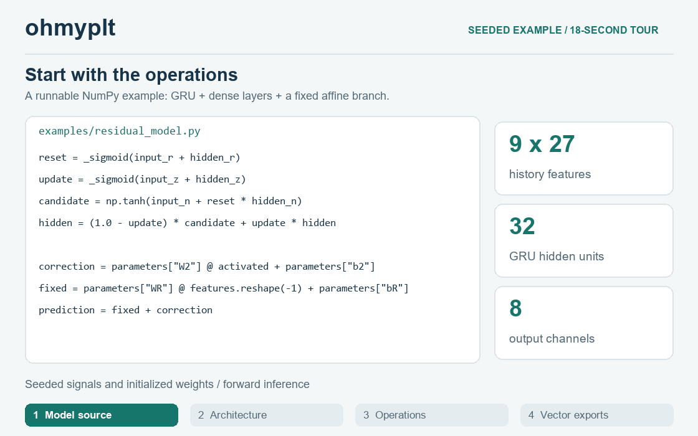
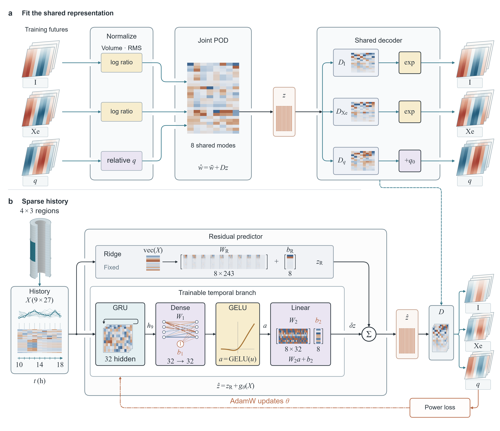
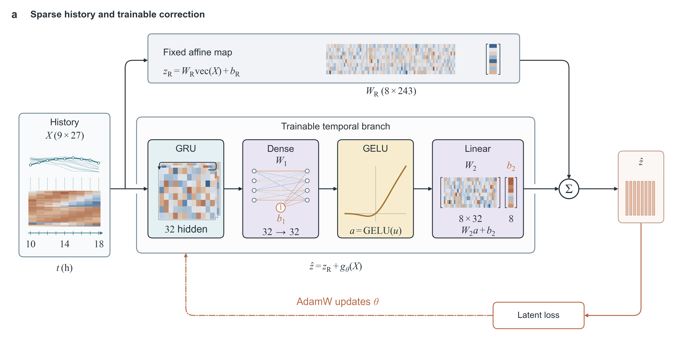
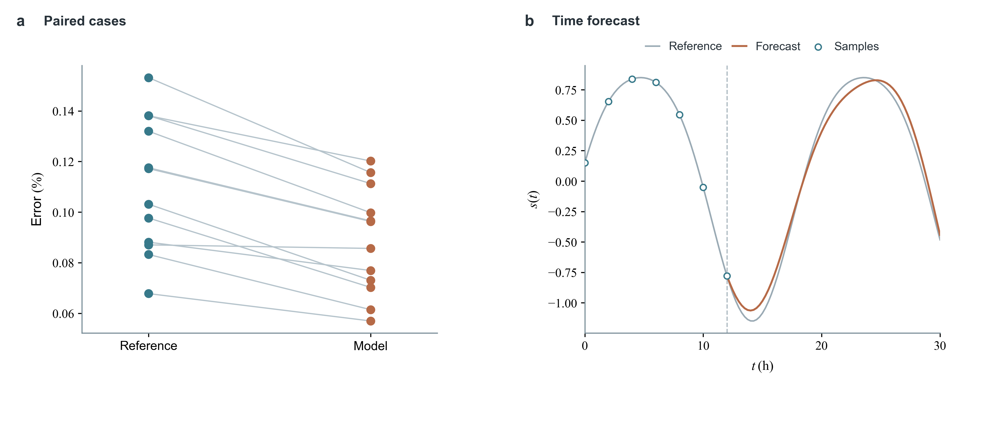
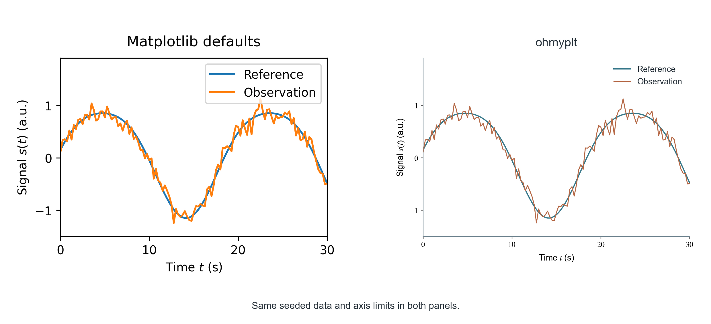

# ohmyplt

**把方法画清楚，细到每一步运算。**

面向科研架构图与数据图的 agent skill。输入模型代码、草图或已有绘图脚本，输出包含真实运算细节与精确连线的科研图，交付文字可编辑的 SVG、PDF/PNG 和 Python 源码。

[English](README.md) · [安装](#安装) · [快速体验](#快速体验) · [画廊](#画廊)

[](https://github.com/Lee-Eee-Eee/ohmyplt/actions/workflows/smoke.yml)



这段 18 秒渲染导览使用固定种子的示例，展示可运行模型源码、导出的完整架构、权重与残差细节，以及实际 PDF 检查结果。[MP4](assets/demo/walkthrough.mp4) · [模型源码](examples/residual_model.py) · [绘图源码](examples/network.py)



这张实际项目图形成了本技能的风格。下面的可运行示例展示其中可复用的组件。

## 可以画什么

- **模型架构**：按实现核对采样历史、GRU 门、带权连接、偏置、仿射映射、残差合流和训练路径。
- **物理示意**：把研究对象、传感器、观测数据、模型与输出连成清楚的阅读路径。
- **数据图**：配对比较、时间曲线、对齐的多面板、明确的单位与统计含义。

用毫米安排布局，按最终尺寸检查可读性。默认 Arial 正文、Times New Roman 数学，连续圆角连线接到明确端口。SVG 保留可编辑文本，PDF 嵌入字体，Python 源码便于复现与修改。

## 安装

使用 [Skills CLI](https://github.com/vercel-labs/skills)，需要 Node.js 22.20+：

```bash
npx skills add Lee-Eee-Eee/ohmyplt --skill ohmyplt
```

按提示选择 agent；加 `-g` 可供各项目使用。运行 Python 工具前，在所用环境中安装依赖。手动安装到 Codex：

```bash
git clone https://github.com/Lee-Eee-Eee/ohmyplt.git ~/.codex/skills/ohmyplt
python -m pip install -r ~/.codex/skills/ohmyplt/requirements.txt
```

在 Codex 中用 `$ohmyplt` 调用；其他 agent 可按各自方式加载 [SKILL.md](SKILL.md)。

## 快速体验

需要 Python 3.10+。在工作目录中克隆并生成三组示例：

```bash
git clone https://github.com/Lee-Eee-Eee/ohmyplt.git
cd ohmyplt
python -m pip install -r requirements.txt
python scripts/quickstart.py --portable --out output
```

`--portable` 明确选择 Matplotlib 自带的 DejaVu Sans/Serif，便于直接体验。默认 Arial/Times 风格使用 `python scripts/quickstart.py --out output`。可用 `--font-dir PATH` 注册自备字体，或用 `--body-font`、`--math-font` 指定字体。

打开 `output/network.png`、`output/data-plot.png` 和 `output/style-comparison.png` 查看成图。同一目录还会保存 SVG/PDF、演示数据、字体与输入清单、最终尺寸预览和 PDF 检查报告。输出目录相对于执行命令时的当前目录。

## 画廊

### 有功能含义的网络架构



[Python 源码](examples/network.py) · [SVG](assets/gallery/network.svg) · [PDF](assets/gallery/network.pdf)

固定种子的演示信号和权重用于展示组件如何表达运算。复现：`python examples/network.py --out output`。

运行对应的 NumPy 前向计算：`python examples/residual_model.py --out output/prediction.json`。重新制作演示需将 ffmpeg 加入 PATH，再运行 `python scripts/build_demo.py`；中间帧与 PDF 检查报告保存在 `output/demo/`。

### 科研数据面板



[Python 源码](examples/data_plot.py) · [SVG](assets/gallery/data-plot.svg) · [PDF](assets/gallery/data-plot.pdf)

配对观测与时间曲线均由固定种子生成。复现：`python examples/data_plot.py --out output`。

### 同一组数据，两种样式



[Python 源码](examples/style_comparison.py) · [SVG](assets/gallery/style-comparison.svg) · [PDF](assets/gallery/style-comparison.pdf)

两个面板的数据、坐标尺度、范围和标签相同。左侧使用 Matplotlib 默认样式，右侧使用 ohmyplt。复现：`python examples/style_comparison.py --out output`。

画廊中的 ohmyplt 样式使用 Arial/Times，比较图的基线保留 Matplotlib 默认样式。单个示例也支持字体参数；快速体验命令会为三个示例统一传入自带字体。

## 三个起步提示

**根据模型代码绘图**

```text
使用 $ohmyplt，根据 model.py 绘制 183 mm 宽的网络架构图。
核对输入输出形状、分支、偏置、共享参数与损失路径。
提供 SVG、PDF、PNG 和 Python 源码。
```

**整理已有草图**

```text
使用 $ohmyplt，把这张草图整理为科研示意图。
保留物理对象、传感器位置与数据流关系，使用接到端口的圆角连线。
提供可编辑 SVG 和 Python 源码。
```

**打磨已有结果图**

```text
使用 $ohmyplt，基于现有数据打磨 plot_results.py。
保留单位、尺度、配对关系和不确定度定义。
对齐比较面板，并按最终尺寸检查 PDF。
```

## 绘图与检查工具

工具包含毫米坐标组件、字体与缺字检查、PDF 实际字高与碰撞检查、原尺寸与局部预览。独立命令和接口见[工具说明](references/tools.md)。自动检查的结果用于指导最后一遍目视修订。

遇到渲染问题或希望补充案例，可[提交 issue](https://github.com/Lee-Eee-Eee/ohmyplt/issues/new/choose)，附最小脚本、可公开的样例输入和期望结果。中英文均可。

## 借鉴与许可

[Nature Figure skill](https://github.com/Yuan1z0825/nature-skills) 提供最终尺寸、矢量输出、字体与碰撞检查等工作流启发；本仓库保留两项原始检查工具及 Apache-2.0 许可。研究图与本项目的多轮实际修改形成了组件设计。详见[来源](references/sources.md)、[第三方说明](THIRD_PARTY_NOTICES.md)和 [Apache-2.0 许可](LICENSE)。
